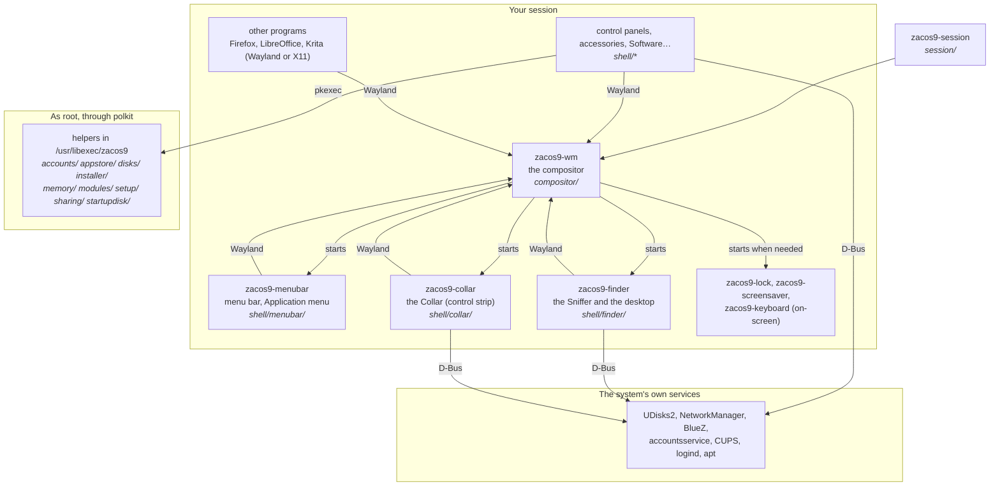

# How ZacOS 9 fits together

ZacOS 9 is a desktop for Debian 13: a Wayland compositor that draws the Mac OS
8 and 9 look, a set of programs that make up the desktop (the menu bar, the
Sniffer, the control panels…), and small root helpers that change the system
for them. This page is the map; each part has its own page in [`docs/`](docs/).

## The processes

**`zacos9-wm`** (`compositor/`, C, wlroots 0.18) is the centre. It shows every
window and draws its Platinum frame, handles the keyboard, mouse, tablets and
touch, arranges the screens, sleeps and locks them, and runs X11 programs
through XWayland. It starts the menu bar, the Sniffer and the Collar, and
starts the lock screen, screen saver and on-screen keyboard when they're
needed.

**The desktop's programs** (`shell/`, a folder and a `meson.build` each) are
separate processes. Most are C++ with Qt 6, but they draw themselves pixel by
pixel with ZacOS's own drawing library (`lib/`) rather than Qt's widgets,
which is how they look exactly like Mac OS 9. The menu bar, lock screen,
screen saver and on-screen keyboard are plain C. A program starts another
from beside itself when installed, from the build tree when it runs from one,
else from `$PATH` (`siblingProgram()` in `shell/common/programs.h`;
`lib/locate.h` for C).

**Root helpers** (`accounts/`, `appstore/`, `disks/`, `installer/`,
`memory/`, `modules/`, `setup/`, `sharing/`, `startupdisk/`) are small scripts
installed in `/usr/libexec/zacos9`. A program runs one with `pkexec`, and its
polkit policy decides who may (usually an administrator, sometimes without a
password). Each checks its arguments itself: it trusts nothing from the
program that ran it. A program run from a build tree uses the source tree's
copy instead (`sourceTreePath()`).

**Everything else** is Debian: UDisks2 for disks, NetworkManager, BlueZ,
accountsservice, CUPS, logind, apt. ZacOS programs talk to them over D-Bus
rather than reimplementing them.

## How they talk

| Channel | What goes over it |
|---|---|
| **Wayland**, standard | Windows (`xdg-shell`), layers above and below them (`wlr-layer-shell`: the menu bar, the Collar, the desktop, the lock screen), the window list for the Application menu (`wlr-foreign-toplevel`), fractional scales. |
| **Wayland**, ZacOS's own (`protocols/`) | `platinum-shell-v1`: a ZacOS program tells the compositor how to frame its window (a movable modal dialog, a utility window…). `zacos-snapshot-v1`: screenshots, for Capture and the tests. `gtk-shell`: GTK programs' menus in the menu bar. |
| **Files in `$XDG_RUNTIME_DIR`** | The compositor publishes its state for programs and tests to read: `zacos9-outputs-*` (the screens, their scales and places, tablets) and `zacos9-idle-*` (awake, screen saver, asleep, locked). The Sniffer listens on `zacos9-finder.*.sock` so a second copy hands its request to the first. |
| **Settings** | `~/.config/zacos9/desktop.conf`, `key=value`: the control panels write it, and the compositor and programs read it (C through `lib/settings.c`). The compositor applies a change as soon as the file changes. |
| **D-Bus**, session | The Sniffer is `org.freedesktop.FileManager1`; `zacos9-file-portal` gives other programs ZacOS's Open and Save dialogs; the Collar is `org.zacos9.Collar`. |
| **D-Bus**, system | UDisks2, NetworkManager, BlueZ and the rest, as above. |
| **`pkexec`** | A program asking a root helper to change the system, with the polkit policies and rules in each helper's folder. |

## Where do I change…

| To change | Look in | Notes |
|---|---|---|
| Window frames, title bars, window behaviour | `compositor/src/` (`decor.c`, `frame.c`, `view.c`) | |
| Keyboard, mouse, tablets, touch | `compositor/src/input.c`, `tablet.c`, `touch.c` | [Touchscreens](docs/touch.md) |
| Screens: arrangement, scale, mirroring | `compositor/src/prefs.c`, `output.c` | The Monitors panel is in `shell/panels/` |
| Sleep, screen saver, lock | `compositor/src/idle.c`, `lock.c`; `shell/screensaver/`, `shell/lock/` | [Energy Saver](docs/energy-saver.md) |
| X11 programs (XWayland) | `compositor/src/xwayland.c`, `xwayland_output.c` | |
| The menu bar and Apple-style menus | `shell/menubar/` (C) | |
| The Collar (the control strip) | `shell/collar/` | [The Collar](docs/collar.md) |
| The Sniffer, the desktop, Get Info | `shell/finder/` | [The Macintosh view](docs/vfs.md) |
| The Open and Save dialogs other programs get (xdg-desktop-portal) | `shell/fileportal/` | |
| Files as the Sniffer shows them, which other programs share: items and their icons, volumes and when to mount them, the Macintosh view, aliases, the Applications database, file associations, thumbnails, desktop printers | `shell/files/` (`libzacos9-files`) | [The Macintosh view](docs/vfs.md) |
| What nearly every desktop program uses: window hints to `zacos9-wm` (`platinumshell`), the alert box, drawing Platinum images in Qt (`pixels.h`), Shut Down and Restart (`power`) | `shell/common/` (`libzacos9-shell`) | |
| A control panel | `shell/panels/` (most in `controlpanel.cpp`) | e.g. [Bluetooth](docs/bluetooth.md), [Memory](docs/memory.md) |
| Appearance: themes, desktop patterns, sound sets | `shell/panels/appearance.cpp` | [Themes and sound sets](docs/themes.md) |
| Software (installing programs), Software Update | `shell/store/`, `shell/update/`; `appstore/` | [Software](docs/appstore.md), [Updates](docs/updates.md) |
| The installer, Disk Setup | `shell/installer/`, `shell/disksetup/`; `installer/` | [Installer](docs/installer.md) |
| File sharing, networking with Macs and Windows | `shell/network/`, `network/afp/`; `sharing/` | [Networking](docs/network.md) |
| Screen Sharing | `shell/screenshare/`, `shell/panels/screensharing.cpp` | [Screen Sharing](docs/screen-sharing.md) |
| Classic Mac programs (SheepShaver) | `shell/classic/`, `emulation/` | [Classic](docs/classic-seamless.md) |
| How other programs look (GTK theme, Qt style) | `share/themes/ZacOS9/`, `shell/qtstyle/` | [Other programs](docs/app-integration.md) |
| Drawing, fonts, icons, patterns shared by everything | `lib/`; masters in `assets/` | Generated headers: `tools/` |
| Start-up: splash, GRUB, the hand-over to the desktop | `boot/` | [Boot](docs/boot.md) |
| Logging in, the session | `session/`, `shell/greeter/` | |
| Hardware quirks | `hardware/` | [Hardware](docs/hardware.md) |
| ZacOS Help | `share/zacos9/help/` | |
| Packages, the ISO, CI | `debian/`, `packaging/`, `iso/`, `.github/` | [Packaging](docs/packaging.md) |

## The rest of the tree

| Folder | What |
|---|---|
| `tests/` | Tests that aren't next to their code yet, the shared headless harness (`tests/disksetup/stage.py`), VM tests (`tests/vm/`) and the build's baselines (`tests/baseline/`). |
| `scripts/` | Build, run, package, ISO, VM and release scripts. |
| `tools/` | Developer tools: icon and font builders, a scripted pointer for tests (`vptr`), screenshot helpers. |
| `docs/` | A page per part, and the [roadmap](docs/ROADMAP.md). |
| `protocols/` | The Wayland protocol files above. |

Folders that are **never** part of ZacOS: `build/` (yours), `macos/`,
`uploads/` and `tools/measure/figs/` (Apple reference material, never
committed or shipped), and `emulation/SheepShaver/` (upstream code).
