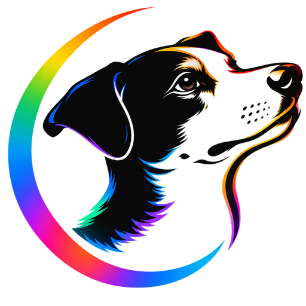
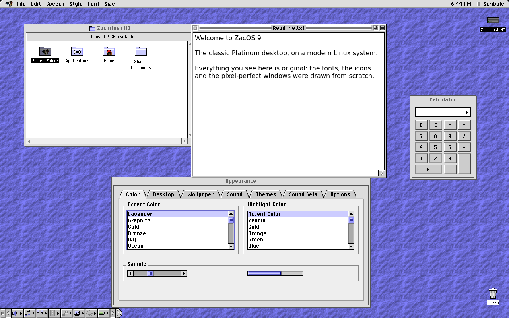
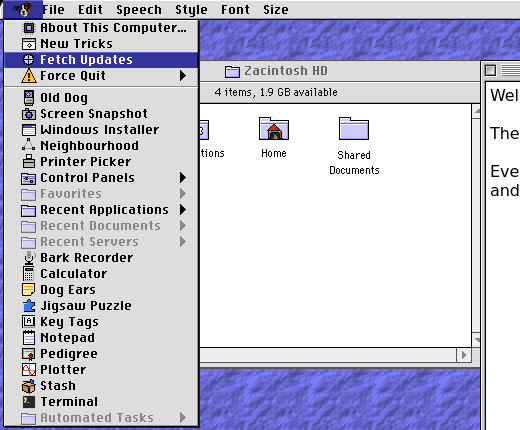
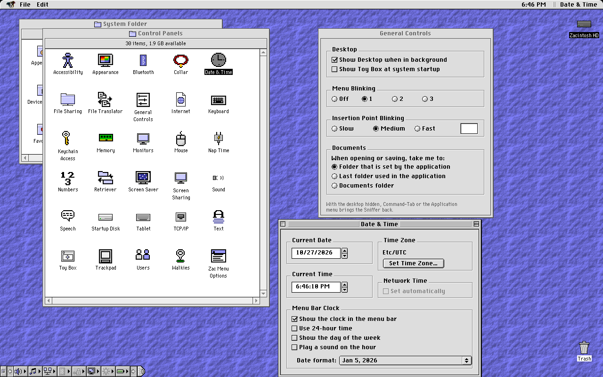
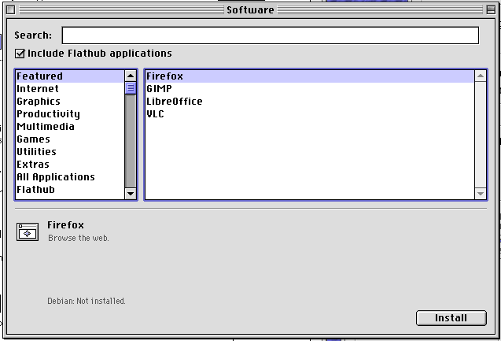
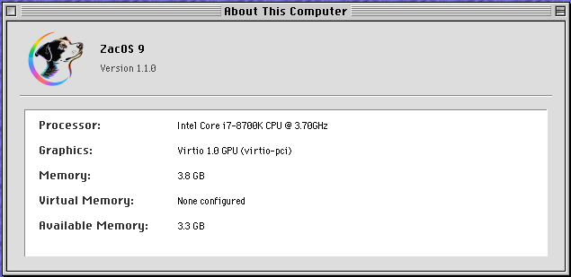
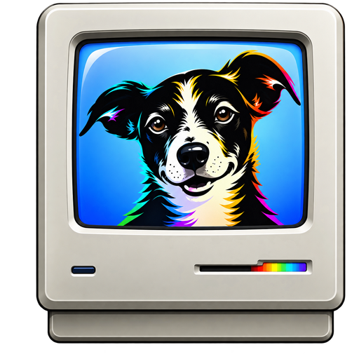

<p align="center">
  
</p>

<h1 align="center">ZacOS 9</h1>

<p align="center">
  <b>The classic Platinum desktop, reborn for modern PCs.</b><br>
  A complete desktop for Debian Linux in the style of Mac OS 8 and 9,
  drawn pixel by pixel from scratch, with classic Mac software one click away.
</p>

<p align="center">
  <a href="https://sourceforge.net/projects/zac-os-9/files/latest/download"></a>
  <a href="https://github.com/chromasystemprofessional/Zac-OS-9/releases/latest"></a>
  <a href="#get-zacos-9"></a>
  <a href="#license"></a>
</p>

<p align="center">
  
</p>

## Why ZacOS 9?

Remember when a computer felt calm? One menu bar, windows that stayed where you
put them, a desktop you could make your own. ZacOS 9 brings that back, on a
system that runs today's web browsers, office suites and games.

It isn't a skin over another desktop. The window manager, the Sniffer (the
file browser), the menu bar and every control panel were written for ZacOS 9,
so everything looks and behaves the same way, down to the scroll arrows.

## What you get

<table>
  <tr>
    <td width="50%"></td>
    <td width="50%"></td>
  </tr>
  <tr>
    <td><b>The Zac menu</b>: desk accessories (Calculator, Notepad, Stash, Dog Ears,
      Key Tags, Bark Recorder), recent programs and documents, and Force Quit.</td>
    <td><b>Real control panels</b>: Appearance, Sound, Monitors, Mouse, Date &amp; Time,
      Energy Saver, Users, File Sharing, Startup Disk and more, each in its own window.</td>
  </tr>
  <tr>
    <td></td>
    <td></td>
  </tr>
  <tr>
    <td><b>Thousands of programs</b>: Firefox, LibreOffice, GIMP, VLC and the rest of
      Debian, plus Flathub, from the Software window. Linux programs wear the
      Platinum look too.</td>
    <td><b>Stays up to date</b>: Software Update (Zac menu ▸ Fetch Updates) installs
      new ZacOS releases and Debian's security fixes together.</td>
  </tr>
</table>

- **The Sniffer**: spatial windows that remember their size and place, a
  Zacintosh HD with a System Folder and Applications, labels, Get Info, Find,
  spring-loaded folders, and `.zip`, `.7z` and StuffIt `.sit` archives opened
  with a double-click.
- **Classic Mac software**: **Old Dog** starts classic Mac OS in the
  SheepShaver emulator. Bring your own ROM and Mac OS install disk.
- **Talks to old Macs**: browse and mount AppleShare (AFP) and Windows (SMB)
  servers in Neighbourhood, even AppleTalk-only Macs, and share your own folders
  back to them with File Sharing. Mac HFS and HFS+ disks and disk images open
  read-only.
- **Windows programs** install through Wine with the Windows Installer.
- **Make it yours**: accent colours, desktop patterns (including classic Mac
  `ppat` resources), wallpaper, themes and sound sets.
- **For the whole family**: separate accounts, Limited accounts and a Guest
  account, Puppy Mode for a simpler Sniffer, a keychain, a screen saver and a
  password-protected screen lock.

<p align="center">
  <br>
  <i>And it starts up like a Mac should: Happy Zac, then the extensions marching along the bottom.</i>
</p>

## Get ZacOS 9

### Try it, then install it (recommended)

1. **Download the ISO** from
   [SourceForge](https://sourceforge.net/projects/zac-os-9/files/latest/download)
   (about 3 GB). A `.sha256` file beside it lets you check the download.
2. **Write it to a USB stick** of 4 GB or more with
   [balenaEtcher](https://etcher.balena.io/) (or `dd` on Linux). This erases the stick.
3. **Start your computer from the stick.** ZacOS 9 opens straight to its desktop,
   so you can try everything without changing your computer.
4. **Install** with the Installer that opens on the desktop: onto a whole disk,
   or onto one partition alongside Windows or another Linux, leaving the
   others alone. On first start, the Setup Assistant asks for your name,
   password and time zone.

You need a 64-bit PC (x86-64) that can start from USB, with BIOS or UEFI
firmware. Back up anything you care about before installing.

The same ISO can also update an older ZacOS 9 on a computer without a network
connection.

### Already running Debian 13?

Download `zacos9_1.0.0_amd64.deb` from the
[latest release](https://github.com/chromasystemprofessional/Zac-OS-9/releases/latest), then:

```sh
sudo apt install ./zacos9_1.0.0_amd64.deb
```

Log out and choose **ZacOS 9** at the login screen. Classic Mac emulation (the
`zacos9-emulators` package) comes on the ISO for now.

## Learn more

- [User guide](docs/user-guide.md): sound, fullscreen programs, the Sniffer, disks, desktop patterns and wallpaper
- [Software and updates](docs/appstore.md) and [Software Update](docs/updates.md)
- [Networking with Macs and Windows](docs/network.md) and [Mac disks](docs/mac-disks.md)
- [Hardware notes](docs/hardware.md) for Macs and other PCs
- ZacOS Help, in the Help menu, from inside the system

## Why ZacOS exists

I built ZacOS for myself. I loved how Mac OS 9 felt to use, and I wanted that
calm, simple desktop on a modern Linux system I use every day.

Once it worked well enough to live in, I decided not to keep it to myself. If it
makes someone else's computer a little more pleasant, that's the whole point.
It's free, the source is all here, and it contains no Apple code, fonts, icons or
sounds.

I'm not selling anything and there's no catch. Bug reports, ideas and
contributions are welcome, and if you'd rather build something different from
it, the GPL lets you.

## Building from source

ZacOS 9 is written in C and C++ (wlroots, Qt 6) and built with Meson on
Debian 13. [Contributing](CONTRIBUTING.md) takes you from a fresh clone to a
running desktop and a passing test; [How ZacOS 9 fits together](ARCHITECTURE.md)
is the map of the code.

Bug reports and ideas are welcome in
[Issues](https://github.com/chromasystemprofessional/Zac-OS-9/issues).

## License

GPL-3.0-or-later.

ZacOS 9 is an independent project, not affiliated with, endorsed by or
sponsored by Apple Inc. Apple, Mac, Mac OS and Macintosh are trademarks of
Apple Inc. No Apple code, ROMs, fonts, icons or sounds are included: every
asset is original or freely licensed. To run classic Mac software, you supply
your own ROM and system software.
