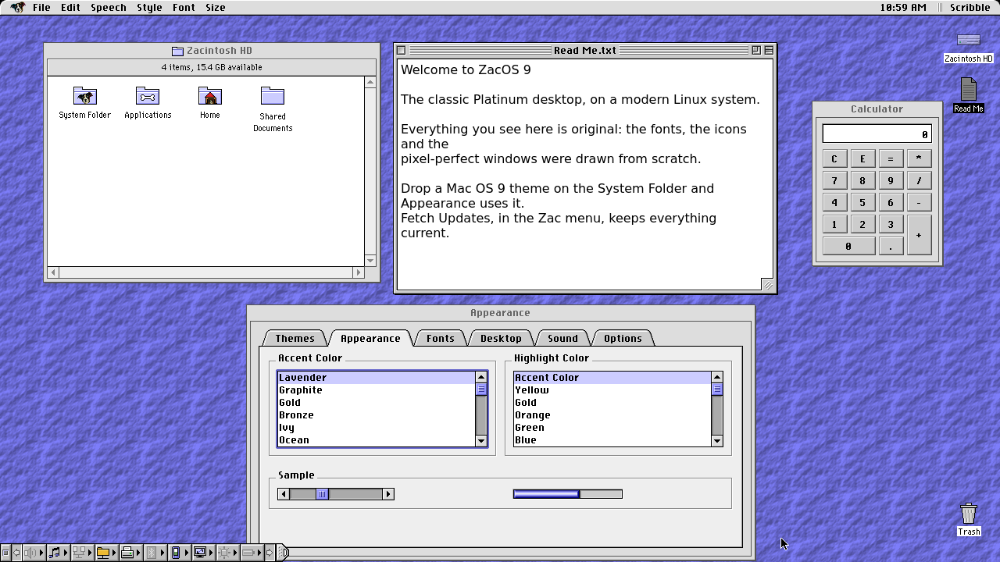

# ZacOS 9

The classic Platinum desktop, reborn for modern PCs: a complete Mac OS 8/9-style
desktop for Debian Linux, written from scratch.



## Which file do I want?

Open the newest `vX.Y.Z` folder and download `zacos9-X.Y.Z-amd64.iso`, with the
`.sha256` file beside it.

1. Check the download: `sha256sum -c zacos9-X.Y.Z-amd64.iso.sha256`
2. Write it to a USB stick of 4 GB or more with [balenaEtcher](https://etcher.balena.io/)
   (or `dd` on Linux). This erases the stick.
3. Start the computer from the stick. ZacOS opens straight to its desktop, so
   you can try everything without changing anything.
4. Install with the Installer on the desktop: onto a whole disk, or onto one
   partition beside Windows or another Linux, leaving the others alone.

Needs a 64-bit PC (x86-64) that can start from USB, with BIOS or UEFI firmware.
Back up anything you care about before installing.

## Already running ZacOS 9?

Zac menu ▸ Fetch Updates brings you the newest ZacOS 9 release, the ZacOS
Extras and Debian's security fixes. You don't need a new ISO.

## Already running Debian 13?

Download the latest `zacos9_*_amd64.deb` from the [latest release on
GitHub](https://github.com/chromasystemprofessional/Zac-OS-9/releases/latest)
and install the file you downloaded:

```sh
sudo apt install ./zacos9_*_amd64.deb
```

Classic Mac emulation (the `zacos9-emulators` package) comes on the ISO for
now.

## Mac OS 9 themes

Drop an original Mac OS 9 appearance theme or Kaleidoscope scheme onto the
System Folder. ZacOS files it into System Folder ▸ Appearance ▸ Theme Files,
reads the theme's own resource fork, and rebuilds the desktop from it: window
chrome and accent, icons and cursors, patterns and sounds. No installer menu
— just a drop. Appearance ▸ Themes also has **New Theme…** and **Edit
Theme…**, including dark themes; editing an imported theme makes a linked
copy so the import stays as it is, and **Artwork…** chooses each window part
as imported, Platinum or your own image.

Theme files come as `.sit`, `.hqx` or `.ksc`, or with no extension; all
import. The theme is built on your computer from your own Mac OS 9 System
Folder, or from the one on Old Dog's startup disk; ZacOS ships no Apple
artwork. See [Themes and sound
sets](https://github.com/chromasystemprofessional/Zac-OS-9/blob/main/docs/themes.md)
for what it reads.

## Newer features

- **Mount network disks at startup.** Tick Mount at startup when connecting
  to an AFP volume or an SMB share; the disk appears in System Folder ▸
  Startup Items with the network-disk icon, and a registered user's password
  is kept in the keychain.
- **After Dark screen savers** can be imported in Control Panels ▸ Screen
  Saver: choose After Dark and click Import…, then pick a disk image, a
  folder of modules or an archive. ZacOS does not include the modules or
  fonts.
- **Hint Bubbles** explain Get Info's icon — ⌘C copies it and ⌘V pastes a
  picture — and the newer menu items.
- **More languages.** Italian, Russian, Spanish, Brazilian Portuguese, French
  (Canada and France) and Arabic are complete, with translated help books.
  Canadian and UK English are selectable English locales; Japanese is a
  display pilot. The installer and Text panel show a country flag beside each
  language.
- **Arabic, right to left.** HarfBuzz shapes Arabic and FriBidi orders it;
  Arabic lists, labels and alerts right-align. The rest of the window layout is
  not mirrored yet.
- **Rotate any screen.** Control Panels ▸ Monitors turns each display by 90°,
  180° or 270°.
- **Speech panel voice lists.** Choose Classic, Modern or Neural voices.

Every release since 1.0 has its notes at
https://github.com/chromasystemprofessional/Zac-OS-9/releases, and the current
state of the project is at
https://github.com/chromasystemprofessional/Zac-OS-9/blob/main/PROJECT_STATUS.md

## Source, help and licence

- Project website: https://chromasystemprofessional.com/zacos9/
- Code, bug reports and ideas: https://github.com/chromasystemprofessional/Zac-OS-9
- What works now and what's next: https://github.com/chromasystemprofessional/Zac-OS-9/blob/main/PROJECT_STATUS.md
- Languages and translations: https://github.com/chromasystemprofessional/Zac-OS-9/blob/main/docs/i18n.md
- Security policy: https://github.com/chromasystemprofessional/Zac-OS-9/security/policy
- Want to help? Start with https://github.com/chromasystemprofessional/Zac-OS-9/blob/main/CONTRIBUTING.md

ZacOS 9 is free and open source (GPL-3.0-or-later). It is an independent
project, not affiliated with, endorsed by or sponsored by Apple Inc. No Apple
code, ROMs, fonts, icons or sounds are included; every asset is original or
freely licensed. To run classic Mac software, you supply your own ROM and
system software.
